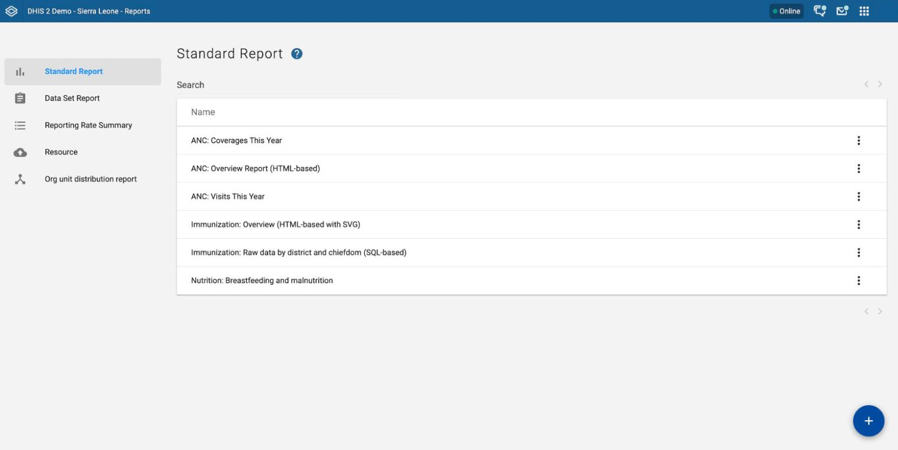
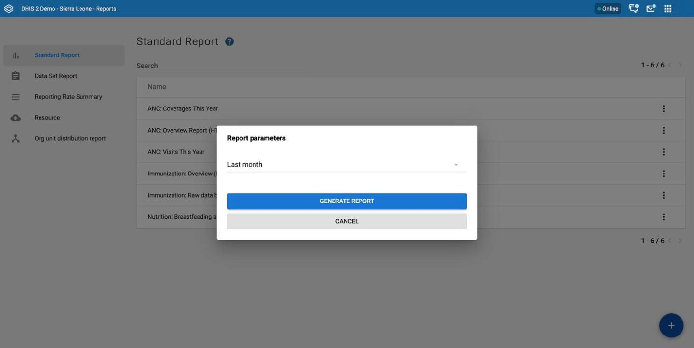
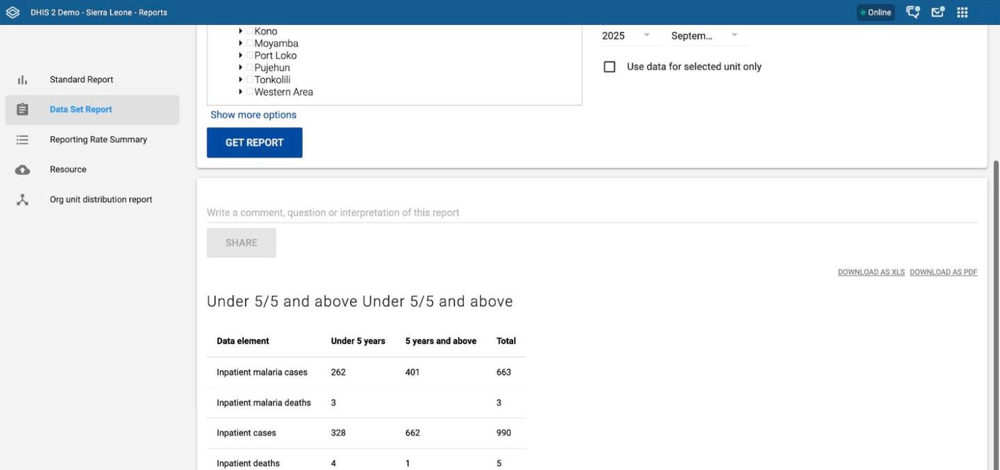
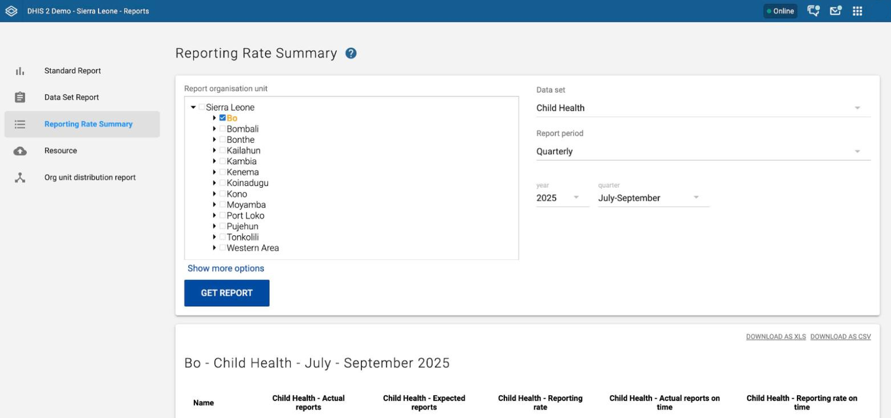
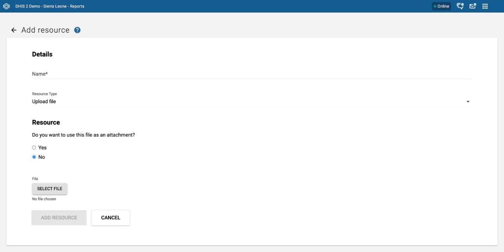
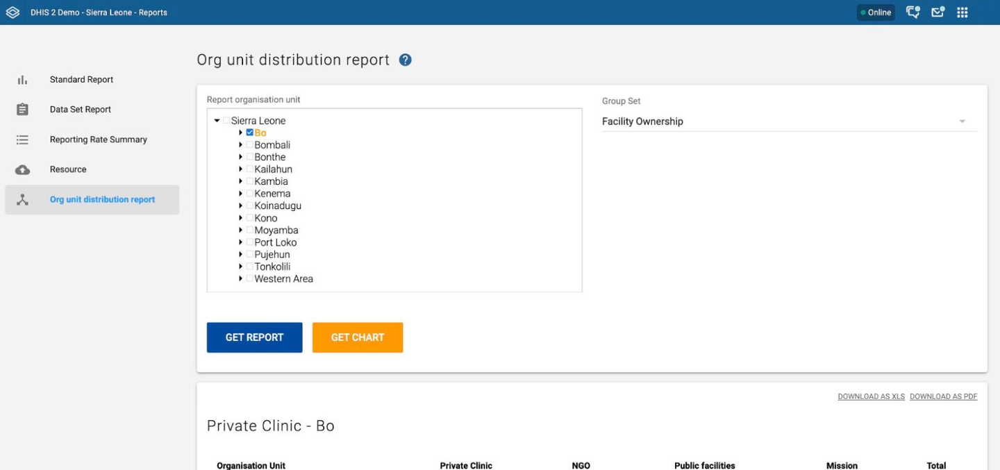

# Reports { #using_the_reports_app }

Use the **Reports** app to run and view reports. The app has five sections: standard reports, data set reports, reporting rate summaries, resources, and organisation unit distribution reports.

To open the app, choose **Reports** in the apps menu. The home page shows a card for each section. When you open a section, the sidebar lets you switch to another section.

> **Note**
>
> The Reports app is under development, and the app that this page describes has known issues. For the status of the work, see the [Reports app rewrite](https://dhis2.atlassian.net/browse/DHIS2-22029) epic (DHIS2-22029) in Jira. This page describes the app in DHIS2 v41 to v43. The page is updated when the new app is released.

## Using standard reports { #standard_reports_in_the_beta_reports_app }

A standard report is a report that an administrator designed in advance. Standard reports use the JasperReports library or an HTML template.

To run a standard report:

1.  In the sidebar, click **Standard Report**. A list of the available standard reports opens. To find a report, type part of its name in the **Search** field.

2.  Open the context menu of the report (the three-dot icon) and choose **Create**.

3.  If the report has parameters, the **Report parameters** window opens. Enter the values that the report needs: an organisation unit, a period, or both. The report design decides which parameters appear.

4.  Click **Generate report**.

If the report has no parameters, DHIS2 generates it as soon as you choose **Create**.

An HTML report opens in the app. To go back to the list, click **Back to standard reports list**. Any other report opens in a new browser tab as a PDF file, or your browser downloads the PDF file. This depends on your browser settings for PDF files. You can save the file and keep it on your computer for later use.

The context menu can also have **Edit**, **Sharing settings**, and **Delete**. DHIS2 shows each of these only if you have the matching access to the report.

The **Report parameters** window shows only the parameters that the report needs. For example, an HTML report can ask for a period only.

## Using data set reports { #dataset_reports_in_the_beta_reports_app }

A data set report shows the data of one data set for one organisation unit and one period. The report contains either raw or aggregated data. If the data set has a custom form, the report is a printer-friendly view of that form. For other data sets, the report is a table.

To run a data set report:

1.  In the sidebar, click **Data Set Report**.

2.  Complete the form:

    **Report organisation unit:** Choose the organisation unit that you want the report for. This unit can be at any level in the hierarchy. DHIS2 aggregates the data up to this level automatically, unless you choose **Use data for selected unit only**.

    **Show more options:** Click this button to show a list for each organisation unit group set. Choose a group in a list to filter the report by that group. Click **Show fewer options** to hide the lists.

    **Data set:** Choose the data set that you want to show.

    **Data set dimensions:** This section appears only if the data set has dimensions. Optionally, choose an option in each list to filter the report.

    **Report period:** Choose the period that you want data for. This can be an aggregated period as well as a raw period. For example, you can ask for a quarterly or annual report even when the data set is collected monthly. A data set's period type (collection frequency) is set in the **Period type** field of the data set in the Metadata Management app. First choose a period type in the list, for example **Monthly**, **Quarterly**, or **Yearly**. Then choose a year and a period in the lists that appear.

    If your instance does not have the Metadata Management app, use the Maintenance app instead.

    **Use data for selected unit only:** Choose this option if the organisation unit has children, and you want only the data collected directly for this unit. DHIS2 then leaves out the data collected by its children. For a typical aggregated report of an organisation unit, do not choose this option.

3.  Click **Get Report**.

The report opens in the app in a printer-friendly format. To print the report or save it as HTML, use the print and save functions of your browser. You can also click **Download as xls** or **Download as pdf** to download the report.

You can also enter a comment, question, or interpretation about the report in the **Write a comment, question or interpretation of this report** field. Click **Share** to share it.

## Using reporting rate summary { #reporting_rate_summary_in_the_beta_reports_app }

The reporting rate summary shows how many data sets (forms) were submitted, by organisation unit and period.

The reporting rate is based on complete data set registrations. A complete data set registration exists when a user marks a data entry form as complete. This is typically done with the **Mark complete** button in the **Data Entry** app. By doing so, the user tells the system that the form is complete. This is a subjective approach to calculating completeness.

For each row, the reporting rate summary shows these measures:

-   **Actual reports:** The number of complete registrations for the data set.

-   **Expected reports:** The number of complete registrations that DHIS2 expects. This number is based on the number of organisation units that the data set is assigned to (enabled for data entry).

-   **Reporting rate:** The percentage of reports registered as complete, based on the number expected.

-   **Actual reports on time:** The same as actual reports, but only for reports registered as complete within the maximum number of days after the end of the reporting period. You can set this number of days for each data set in the field **Number of days after period to qualify for on time submission** in the Metadata Management app. In the Maintenance app, the field is **Days after period to qualify for timely submission**.

-   **Reporting rate on time:** The same as the reporting rate, but with the reports registered as complete on time as the numerator.

To run the report:

1.  In the sidebar, click **Reporting Rate Summary**.

2.  In the organisation unit tree, choose an organisation unit. The report shows this unit and its direct children.

3.  Choose a data set.

4.  Choose a period type. Then choose a year and a period from the lists that appear.

5.  Click **Get Report**. The report opens as a table. To see other results, change any of the parameters and click **Get Report** again.

You can also click **Download as xls** or **Download as csv** to download the table.

## Using resources { #resources_in_the_beta_reports_app }

With resources, you can upload files from your local computer to the DHIS2 server. You can also add links to other resources on the internet through URLs. If cloud storage is configured for your system, DHIS2 saves the files there.

To create a resource:

1.  Open the **Reports** app and click **Resource** in the sidebar.

2.  Click the add button (**+**). The **Add resource** page opens.

3.  In the **Name** field, enter a name.

4.  In **Resource Type**, choose **Upload file** or **External url**.

    -   For **Upload file**, click **Select file** and choose the file on your computer. Under **Do you want to use this file as an attachment?**, choose **Yes** or **No**.

    -   For **External url**, enter the address of the resource in the **Url** field.

5.  Click **Add resource**.

To open a resource, open its context menu in the list and choose **View Resource**. To edit a resource, change its sharing settings, or delete it, choose **Edit Resource**, **Sharing settings**, or **Delete** in the same menu. You cannot edit a resource that is a file. You can only create it again.

## Using organisation unit distribution reports { #orgunit_distribution_reports_in_the_beta_reports_app }

Organisation unit distribution reports show how organisation units are distributed by properties such as type and ownership, and by geographical areas. The result can be a table or a chart.

To run a report:

1.  In the sidebar, click **Org unit distribution report**.

2.  In the organisation unit tree on the left, choose an organisation unit. The table shows the selected organisation unit and its direct children.

3.  In **Group Set**, choose the organisation unit group set that you want to use. Typical group sets are type, ownership, and rural or urban. You can use any user-defined organisation unit group set.

4.  Click **Get Report** for a table, or **Get Chart** for a chart of the same result.

For the table, you can also click **Download as xls** or **Download as pdf**.

